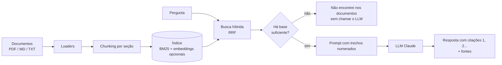

# 📚 RAG Docs Assistant

Assistente de perguntas e respostas sobre documentos (PDF, Markdown, TXT) que **responde com citação das fontes** e **se recusa a responder quando a informação não está nos documentos**. Construído em Python com busca híbrida, LLM (Claude), API REST e interface web.


> **Demo:** adicione aqui um GIF ou print da interface Streamlit (`docs/demo.gif`).

## Por que este projeto

Respostas de LLM sem base em documentos podem ser inventadas. Aqui o objetivo é o oposto: **toda resposta vem de trechos recuperados, com a fonte indicada, e o sistema diz "não encontrei" quando não há base**. O foco do projeto está na engenharia ao redor do modelo: recuperação, prompt, guardas, testes e avaliação.

## Como funciona



## Decisões técnicas

- **Chunking por seção.** Títulos Markdown iniciam novos trechos. Na primeira versão, seções pequenas eram agrupadas no mesmo chunk e uma pergunta sobre reembolso trazia o trecho errado primeiro. O teste de ponta a ponta revelou isso e a correção ficou coberta por teste.
- **Busca híbrida.** BM25 implementado do zero (com normalização de acentos, plural simples e stopwords em português) como base. Embeddings multilíngues são opcionais (`USE_DENSE=1`) e se combinam ao BM25 por *Reciprocal Rank Fusion*.
- **Recusa antes de gastar token.** Se nenhum trecho cobre uma fração mínima dos termos da pergunta (`MIN_COVERAGE`), o sistema responde "não encontrei" **sem chamar o LLM**. Isso reduz custo e alucinação.
- **Prompt defensivo.** O modelo só pode usar os trechos fornecidos, deve citar `[n]` e é instruído a tratar o conteúdo dos documentos como *dados, não instruções* (mitigação básica de prompt injection, com teste).
- **Funciona sem chave de API.** Sem `ANTHROPIC_API_KEY`, entra um modo extrativo que mostra os trechos mais relevantes. Dá para rodar, testar e demonstrar o pipeline de graça.
- **LLM atrás de uma interface (`Protocol`).** Trocar de provedor ou usar um modelo falso nos testes exige mudar uma classe.

## Como rodar

```bash
git clone https://github.com/NicolasPeresCS/rag-docs-assistant && cd rag-docs-assistant
python -m venv .venv && source .venv/bin/activate
pip install -e ".[dev,ui]"
cp .env.example .env
```

**CLI**
```bash
python -m ragdocs.cli index
python -m ragdocs.cli ask "Quantos dias de home office por semana?"
```

**API** (docs interativas em `http://localhost:8000/docs`)
```bash
uvicorn ragdocs.api:app --reload
curl -X POST localhost:8000/ask -H 'content-type: application/json' \
     -d '{"question": "Quanto custa o plano Business?", "top_k": 3}'
```

**Interface web** (permite enviar seus próprios PDFs)
```bash
streamlit run app.py
```

**Docker**
```bash
docker build -t rag-docs . && docker run -p 8000:8000 -e ANTHROPIC_API_KEY=... rag-docs
```

**Seus documentos:** coloque arquivos em uma pasta e defina `DOCS_DIR=minha/pasta`, depois rode `index`.
**Embeddings (opcional):** `pip install -e ".[dense]"` e `USE_DENSE=1`.

## Testes e avaliação

```bash
pytest -q                    # 31 testes
python eval/run_eval.py      # métricas de recuperação, sem LLM
```

Resultado atual no conjunto de exemplo (13 perguntas dentro do escopo e 3 fora):

| Métrica | Resultado |
|---|---|
| hit@3 (fonte certa entre os 3 primeiros trechos) | 1.00 |
| MRR | 1.00 |
| Recusa correta de perguntas fora do escopo | 1.00 |
| Perguntas dentro do escopo respondidas | 1.00 |

**Leia com cautela:** o conjunto é pequeno (16 perguntas, 3 documentos) e os limiares foram ajustados nele, então esses números mostram que o pipeline funciona, não que ele generalize. O teste `tests/test_eval.py` serve como guarda de regressão no CI. Para uma avaliação real seria preciso um conjunto maior, com documentos e perguntas de outros domínios.

## Estrutura

```
src/ragdocs/
  loaders.py     leitura de PDF/MD/TXT
  chunking.py    divisão por seção e parágrafo
  retriever.py   BM25 + índice denso + fusão RRF
  llm.py         cliente Claude e modo extrativo
  pipeline.py    orquestra recuperação, recusa, prompt e fontes
  api.py         FastAPI (/ask, /reindex, /health)
  cli.py         linha de comando
app.py           interface Streamlit
eval/            conjunto de perguntas e script de métricas
tests/           testes unitários e de API
```

## Limitações

- O critério de recusa é lexical (cobertura de termos). Perguntas com sinônimos ("automóvel" vs "carro") podem ser recusadas sem o modo de embeddings.
- Não há reranking, streaming de resposta nem histórico de conversa: cada pergunta é independente.
- PDFs escaneados (imagem) não funcionam, pois não há OCR.
- A busca é feita em memória: serve para centenas de documentos, não para milhões.

## Licença

MIT
